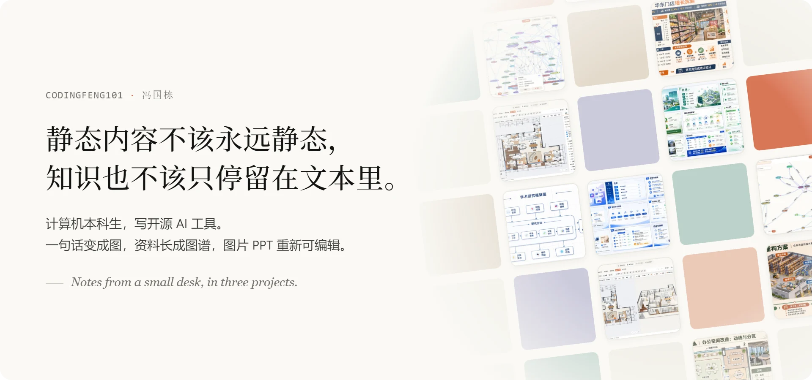
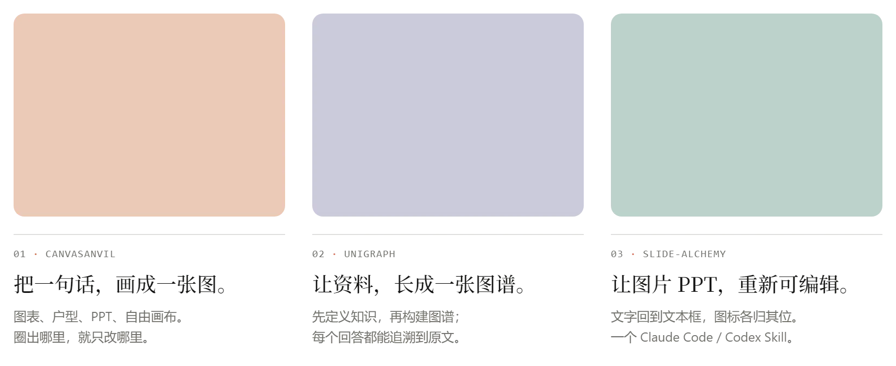
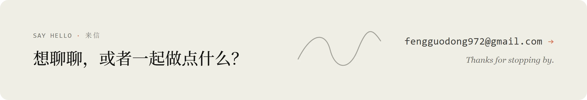

<picture>
  <source media="(prefers-reduced-motion: reduce) and (prefers-color-scheme: dark)" srcset="assets/hero-dark.webp">
  <source media="(prefers-reduced-motion: reduce)" srcset="assets/hero-light.webp">
  <source media="(prefers-color-scheme: dark)" srcset="assets/hero-motion-dark.webp">
  
</picture>

 

<picture>
  <source media="(prefers-reduced-motion: reduce) and (prefers-color-scheme: dark)" srcset="assets/cards-dark.webp">
  <source media="(prefers-reduced-motion: reduce)" srcset="assets/cards-light.webp">
  <source media="(prefers-color-scheme: dark)" srcset="assets/cards-motion-dark.webp">
  
</picture>

  <a href="https://github.com/CodingFeng101/CanvasAnvil"><b>CanvasAnvil</b></a>&nbsp; <a href="https://canvasanvil.codingfgd.asia">在线使用</a> · <a href="https://github.com/CodingFeng101/CanvasAnvil/blob/main/README.zh-CN.md#视频教程">视频教程</a>
  &nbsp;&nbsp;/&nbsp;&nbsp;
  <a href="https://github.com/CodingFeng101/UniGraph"><b>UniGraph</b></a>&nbsp; <a href="https://unigraph.jxselab.com/login">在线体验</a> · <a href="https://github.com/CodingFeng101/UniGraph#-视频教程">视频教程</a>
  &nbsp;&nbsp;/&nbsp;&nbsp;
  <a href="https://github.com/CodingFeng101/slide-alchemy"><b>slide-alchemy</b></a>&nbsp; <a href="https://github.com/CodingFeng101/slide-alchemy/blob/main/README.zh-CN.md#-演示视频">演示视频</a>

Python · FastAPI · Vue 3 · React · TypeScript · Agent Skills

 

<a href="mailto:fengguodong972@gmail.com"><picture>
  <source media="(prefers-color-scheme: dark)" srcset="assets/outro-dark.webp">
  
</picture></a>
